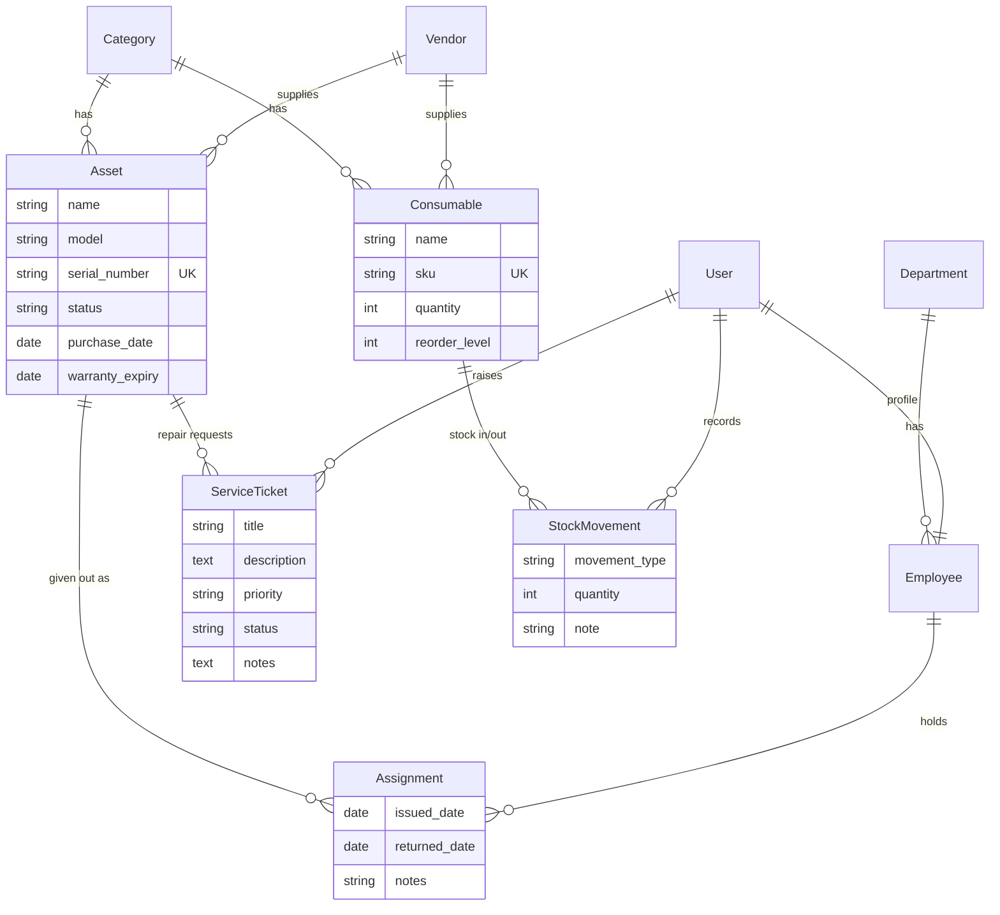

# IT Asset Manager

A Django project I built to practise Django and Django REST Framework. It keeps track of the
hardware an IT team looks after: laptops, monitors, switches and so on. You can see who has what,
raise repair tickets, and keep an eye on small stock like cables and toner.

I made it with a small IT/hardware company in mind (stock room, staff laptops, repair requests).
All the data in the seed command is made up.

## What it does

- Login, logout and signup. Two roles using Django Groups:
  - **IT Staff** (and superusers) can manage everything.
  - **Employee** can see only the assets assigned to them and raise/track their own tickets.
- Assets with serial number, model, category, vendor, status (in stock / assigned / in repair / retired),
  purchase date and warranty end date.
- Assignments: give an asset to an employee, mark it returned. The asset status changes by itself.
- Service tickets with priority and status. Moving a ticket to "in progress" puts the asset "in repair";
  resolving it puts it back.
- Consumables (cables, ink, chargers) with a quantity and reorder level. The quantity only changes
  through stock in / stock out records, and it can never go below zero.
- Dashboard: asset counts by status, low stock items, warranties ending in 60 days, open tickets.
- Search, filters and pagination on the list pages.
- Django admin with list_display, search and filters for every model.
- REST API with token or session login.

## Models



## Setup

You need Python 3.11 or newer.

```bash
git clone https://github.com/Shibukedang27/it-asset-manager.git
cd it-asset-manager

python -m venv .venv
source .venv/bin/activate        # on Windows: .venv\Scripts\activate
pip install -r requirements.txt

cp .env.example .env             # then put your own SECRET_KEY in it
python manage.py migrate
python manage.py seed_data       # optional sample data
python manage.py runserver
```

Open http://127.0.0.1:8000/. The seed command creates these accounts (password `demo12345`,
demo only):

| User | Role |
|------|------|
| admin | superuser |
| itstaff | IT Staff |
| anita, suresh, meena | Employee |

Without the seed data you can make your own admin with `python manage.py createsuperuser`.
New people who sign up on the site get the Employee role. To make someone IT Staff, add them to
the "IT Staff" group in the admin.

### Settings from the environment

`SECRET_KEY`, `DEBUG` and `ALLOWED_HOSTS` are read from environment variables (or a `.env` file).
`.env` is in `.gitignore`, `.env.example` shows the names. `DEBUG` is off unless you set it to `True`.

## Pages

| URL | Who | What |
|-----|-----|------|
| `/` | everyone logged in | dashboard |
| `/assets/` | all (employees see only their own) | list with search + filters |
| `/assets/add/`, `/assets/<id>/edit/`, `/assets/<id>/delete/` | IT Staff | create / update / delete |
| `/assignments/` | all (employees see own) | list, mark returned (staff) |
| `/tickets/` | all (employees see own) | list, raise a ticket, staff can update |
| `/consumables/`, `/stock/` | IT Staff | consumables, stock in/out log |
| `/admin/` | staff | Django admin |

## API

Base URL is `/api/`. Get a token and send it in the `Authorization` header:

```bash
curl -X POST -d "username=itstaff&password=demo12345" http://127.0.0.1:8000/api/token/
curl -H "Authorization: Token <token>" http://127.0.0.1:8000/api/assets/
```

The browsable API at `/api/` also works after logging in at `/api-auth/login/`.
Lists are paginated (10 per page).

| Endpoint | Methods | Notes |
|----------|---------|-------|
| `/api/token/` | POST | username + password, returns a token |
| `/api/categories/`, `/api/vendors/`, `/api/departments/` | GET; POST/PUT/PATCH/DELETE for IT Staff | |
| `/api/employees/` | GET (IT Staff) | read only |
| `/api/assets/` | GET, POST | `?search=`, `?status=`, `?category=`, `?ordering=`. Employees only see their assets |
| `/api/assets/<id>/` | GET, PUT, PATCH, DELETE | writes are IT Staff only; delete gives 409 if the asset has history |
| `/api/assets/warranty-expiring/` | GET | `?days=60` |
| `/api/assignments/` | GET, POST | POST is IT Staff only, asset must be in stock |
| `/api/assignments/<id>/return/` | POST | mark returned (IT Staff) |
| `/api/tickets/` | GET, POST | `?status=`, `?priority=`, `?search=`. Employees see and raise their own |
| `/api/tickets/<id>/` | GET, PUT, PATCH, DELETE | updating is IT Staff only |
| `/api/consumables/` | GET, POST, PUT, PATCH | IT Staff, `quantity` is read only |
| `/api/consumables/low-stock/` | GET | quantity at or below reorder level |
| `/api/stock-movements/` | GET, POST | IT Staff, cannot be edited or deleted |

## Tests

```bash
python manage.py test
```

There are tests for the models (status changes, negative stock), the views (permissions, search,
pagination) and the API (token login, permissions, validation). GitHub Actions runs them on every push.

## Project layout

```
config/            settings, root urls
assets/models.py   all models and their rules
assets/views.py    class based views for the HTML pages
assets/forms.py    model forms
assets/api.py      DRF viewsets      (serializers.py, permissions.py, api_urls.py)
assets/roles.py    is_it_staff() helper
assets/tests/      model, view and API tests
assets/management/commands/seed_data.py
templates/         base, login and signup pages
assets/templates/  app pages (bootstrap from a CDN)
```

## Things I'd improve

- Deploy it (it only runs locally for now).
- Pages for managing categories, vendors and employees. Right now that is done in the admin or the API.
- Ticket comments instead of one notes box, and email when a ticket changes.
- An asset can only have one holder at a time, which is checked in code. A database constraint would be safer.
- Switch to PostgreSQL for real use, SQLite is only for development.
- Add screenshots to this README.
